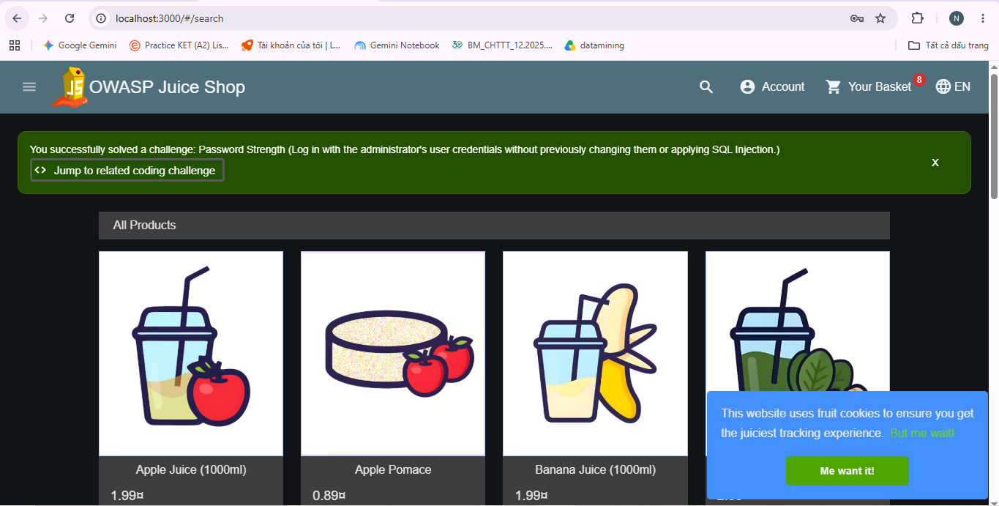
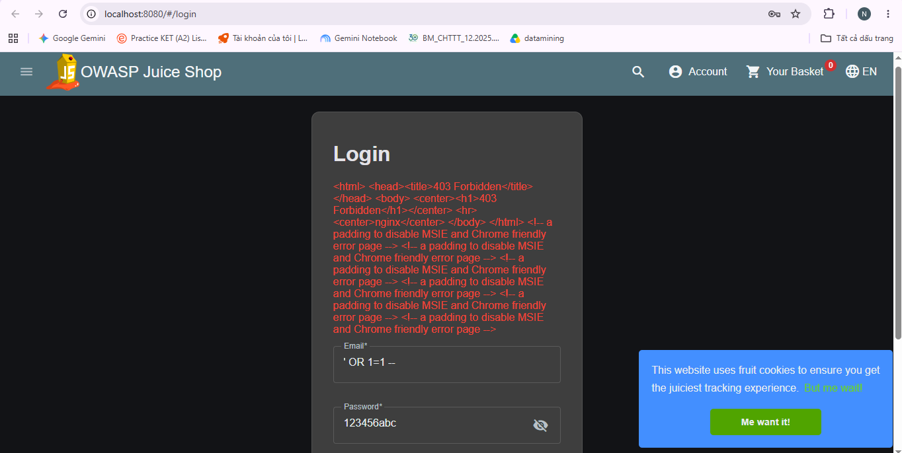
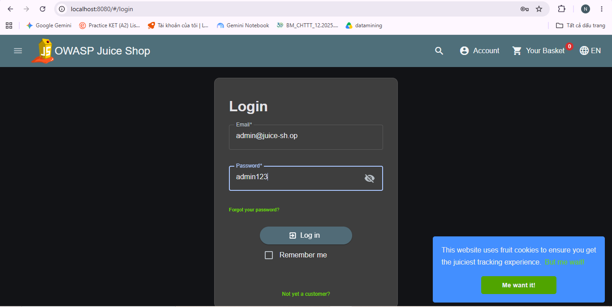

# Bài Thực Hành: WAF trên Nginx

Bài thực hành triển khai Web Application Firewall (WAF) bằng cách sử dụng Nginx, ModSecurity và bộ luật OWASP CRS để bảo vệ ứng dụng web (OWASP Juice Shop) khỏi các cuộc tấn công phổ biến.

## Yêu cầu hệ thống
- Docker
- Docker Compose

## Các tệp tin
- `docker-compose.yml`: File cấu hình triển khai các service (WAF và Backend web).
- `README.md`: Hướng dẫn chạy và kiểm thử hệ thống.

## Hướng dẫn triển khai
1. Mở terminal tại thư mục chứa project này.
2. Chạy lệnh khởi động các container:
   ```bash
   docker compose up -d
   ```

## Các kịch bản kiểm thử (Test Cases)

### 1. Thử tấn công trực tiếp (Không có WAF)
- Truy cập: `http://localhost:3000` (Cổng đi thẳng vào backend)
- Payload SQL Injection (Email): `' OR 1=1 --`
- Mật khẩu: (Nhập bất kỳ)
- **Kết quả:** Đăng nhập thành công vào tài khoản admin. 


### 2. Thử tấn công qua WAF
- Truy cập: `http://localhost:8080` (Cổng đi qua WAF Nginx)
- Payload SQL Injection (Email): `' OR 1=1 --`
- Mật khẩu: (Nhập bất kỳ)
- **Kết quả:** Trình duyệt trả về lỗi **403 Forbidden** (WAF đã chặn thành công).


### 3. Đăng nhập hợp lệ qua WAF
- Truy cập: `http://localhost:8080`
- Tài khoản: `admin@juice-sh.op`
- Mật khẩu: `admin123`
- **Kết quả:** Đăng nhập thành công bình thường.


### 4. Kiểm tra Log WAF
Để xem chi tiết lý do chặn ở bước 2, chạy lệnh:
```bash
docker compose logs waf
```
- **Kết quả:** Log sẽ hiển thị hệ thống đã bắt được tấn công SQL Injection và kích hoạt **luật 942100**.
